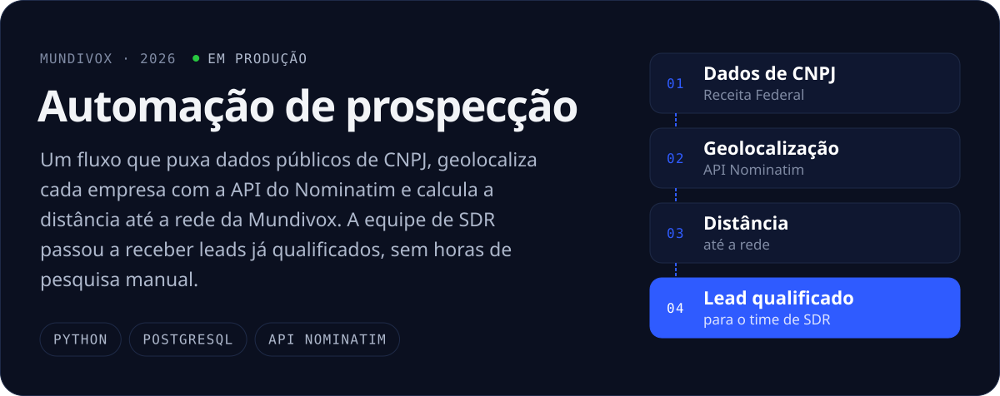

  <!-- TODO: troque https://SEU-PORTFOLIO-AQUI pelo endereço do portfólio (aparece 2 vezes) -->
  &nbsp;
  

 

Engenheiro de Software com foco em back-end. Trabalho com Python e PostgreSQL, e hoje desenvolvo software e automatizo processos na Mundivox.

Comecei a programar pela lógica e fui parar no back-end porque gosto de entender de onde o dado vem e para onde ele vai. Estudo Engenharia de Software na FIAP e moro em São Paulo.

 

 

 

  
  

 

